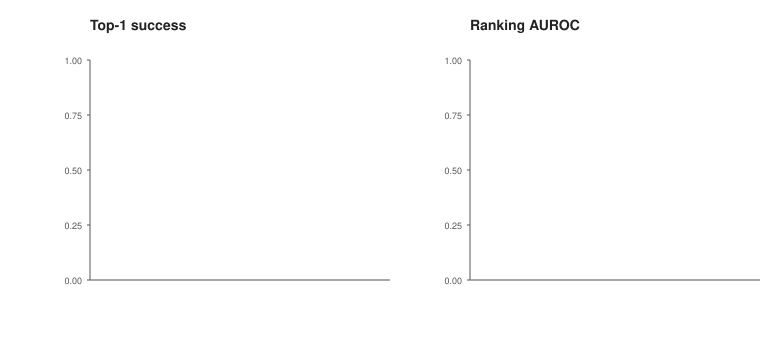
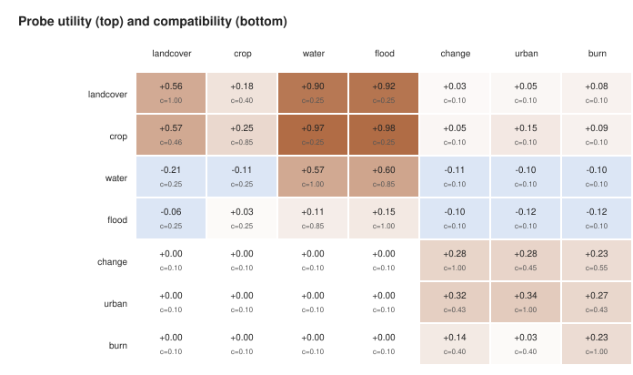
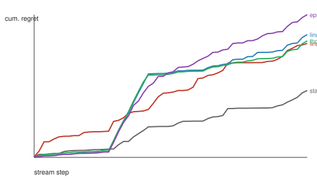

# GeoCompass experiment report

Seeds: 0, 1, 2. Tasks per seed: {'source_train': 70, 'source_val': 28, 'target_dev': 56, 'target_test': 42, 'stream': 56}. Mean skill-library size: 20.0. Total runtime: 680 s.

## 1. Skill selection quality

| Method | Success | 95% CI | Score | Negative transfer | AUROC | AUPRC | Brier | NLL | ECE | P@1 |
|---|---:|---:|---:|---:|---:|---:|---:|---:|---:|---:|
| random | 0.349 | [0.270, 0.437] | 0.389 | 0.294 | 0.495 | 0.369 | 0.334 | 1.007 | 0.284 | 0.333 |
| semantic | 0.500 | [0.413, 0.587] | 0.505 | 0.183 | 0.666 | 0.547 | 0.233 | 1.127 | 0.152 | 0.500 |
| frequency | 0.540 | [0.452, 0.619] | 0.524 | 0.198 | 0.509 | 0.362 | 0.246 | 0.686 | 0.138 | 0.540 |
| logistic | 0.683 | [0.595, 0.762] | 0.632 | 0.056 | 0.842 | 0.655 | 0.164 | 0.491 | 0.120 | 0.683 |
| temperature | 0.683 | [0.595, 0.762] | 0.632 | 0.056 | 0.842 | 0.655 | 0.165 | 0.494 | 0.105 | 0.683 |
| isotonic | 0.675 | [0.587, 0.754] | 0.629 | 0.056 | 0.842 | 0.661 | 0.156 | 0.629 | 0.063 | 0.675 |
| fewshot | 0.683 | [0.595, 0.762] | 0.632 | 0.056 | 0.841 | 0.654 | 0.157 | 0.612 | 0.087 | 0.683 |
| isotonic_budget | 0.746 | [0.667, 0.817] | 0.701 | 0.286 | 0.842 | 0.661 | 0.156 | 0.629 | 0.063 | 0.675 |
| oracle (candidate upper bound) | 0.802 | [0.730, 0.865] | 0.753 | 0.000 | - | - | - | - | - | - |


## 2. Calibration

Reliability diagram over all target-task candidate skills, averaged across seeds. The diagonal is perfect calibration.


## 3. Feature ablation

All variants use isotonic calibration and the same candidate pool; only the discriminator features change.

| Feature set | Success | Score | AUROC | ECE |
|---|---:|---:|---:|---:|
| semantic | 0.500 | 0.504 | 0.664 | 0.073 |
| structural | 0.675 | 0.629 | 0.842 | 0.063 |
| history | 0.579 | 0.586 | 0.784 | 0.073 |
| curated | 0.619 | 0.613 | 0.852 | 0.070 |
| full | 0.611 | 0.610 | 0.854 | 0.077 |



## 4. Cross-task transfer diagnosis

| Gate strategy | Success | Score | Negative transfer |
|---|---:|---:|---:|
| none | 0.675 | 0.629 | 0.056 |
| semantic | 0.579 | 0.559 | 0.103 |
| outcome | 0.675 | 0.629 | 0.056 |
| proposed | 0.698 | 0.647 | 0.048 |

### Source-to-target transferability

Each cell reports the mean probe utility and structural compatibility estimated on the target development split.



### Representative source-to-target pairs

| Pair | Strategy | Success | Negative transfer | Blocked skills | Library |
|---|---|---:|---:|---:|---:|
| landcover->change | none | 0.056 | 0.222 | 0.0 | 2.0 |
| landcover->change | semantic | 0.056 | 0.222 | 0.0 | 2.0 |
| landcover->change | proposed | 0.000 | 0.000 | 2.0 | 2.0 |
| landcover->change | oracle | 0.056 | 0.000 | 0.0 | 2.0 |
| change->landcover | none | 0.000 | 1.000 | 0.0 | 3.0 |
| change->landcover | semantic | 0.000 | 1.000 | 0.0 | 3.0 |
| change->landcover | proposed | 0.000 | 0.000 | 3.0 | 3.0 |
| change->landcover | oracle | 0.000 | 0.000 | 0.0 | 3.0 |
| water->flood | none | 1.000 | 0.000 | 0.0 | 4.7 |
| water->flood | semantic | 1.000 | 0.000 | 0.0 | 4.7 |
| water->flood | proposed | 1.000 | 0.000 | 0.0 | 4.7 |
| water->flood | oracle | 1.000 | 0.000 | 0.0 | 4.7 |
| flood->water | none | 0.000 | 0.000 | 0.0 | 1.0 |
| flood->water | semantic | 0.000 | 0.000 | 0.0 | 1.0 |
| flood->water | proposed | 0.000 | 0.000 | 0.0 | 1.0 |
| flood->water | oracle | 0.000 | 0.000 | 0.0 | 1.0 |
| crop->landcover | none | 0.944 | 0.000 | 0.0 | 5.7 |
| crop->landcover | semantic | 0.944 | 0.000 | 0.0 | 5.7 |
| crop->landcover | proposed | 0.944 | 0.000 | 0.0 | 5.7 |
| crop->landcover | oracle | 0.944 | 0.000 | 0.0 | 5.7 |
| landcover->crop | none | 0.611 | 0.056 | 0.0 | 2.0 |
| landcover->crop | semantic | 0.611 | 0.056 | 0.0 | 2.0 |
| landcover->crop | proposed | 0.611 | 0.056 | 0.0 | 2.0 |
| landcover->crop | oracle | 0.611 | 0.000 | 0.0 | 2.0 |
| change->urban | none | 0.667 | 0.444 | 0.0 | 3.0 |
| change->urban | semantic | 0.667 | 0.444 | 0.0 | 3.0 |
| change->urban | proposed | 0.667 | 0.444 | 1.0 | 3.0 |
| change->urban | oracle | 0.667 | 0.000 | 0.0 | 3.0 |
| urban->change | none | 0.667 | 0.278 | 0.0 | 1.7 |
| urban->change | semantic | 0.667 | 0.278 | 0.0 | 1.7 |
| urban->change | proposed | 0.611 | 0.167 | 0.7 | 1.7 |
| urban->change | oracle | 0.667 | 0.000 | 0.0 | 1.7 |
| urban->burn | none | 0.333 | 0.222 | 0.0 | 1.7 |
| urban->burn | semantic | 0.333 | 0.222 | 0.0 | 1.7 |
| urban->burn | proposed | 0.333 | 0.056 | 0.7 | 1.7 |
| urban->burn | oracle | 0.333 | 0.000 | 0.0 | 1.7 |
| burn->urban | none | 0.056 | 0.944 | 0.0 | 2.0 |
| burn->urban | semantic | 0.056 | 0.944 | 0.0 | 2.0 |
| burn->urban | proposed | 0.056 | 0.444 | 1.0 | 2.0 |
| burn->urban | oracle | 0.056 | 0.000 | 0.0 | 2.0 |

## 5. Tiered experience memory

Prequential evaluation on a held-out stream. Each method selects a skill before observing the outcome and then ingests the outcome.

| Memory mode | Success | Score | ECE | Retained records | Characters | Duplicate ratio |
|---|---:|---:|---:|---:|---:|---:|
| none | 0.774 | 0.709 | 0.232 | 0 | 0 | 0.000 |
| flat | 0.780 | 0.699 | 0.113 | 616 | 57315 | 0.000 |
| tiered | 0.780 | 0.702 | 0.131 | 106 | 9535 | 0.000 |
| tiered_dedup | 0.786 | 0.707 | 0.141 | 104 | 9428 | 0.500 |
| full | 0.774 | 0.705 | 0.120 | 109 | 9987 | 0.492 |


## 6. Candidate retrieval

Each stage trains its own calibrated reranker on that stage's candidate pool. `hashed` is the bag-of-words embedding used by earlier runs, `bm25` is lexical only, and `hybrid` fuses both by reciprocal rank. Candidate ceiling is the fraction of tasks where at least one retrieved candidate beats the generic baseline.

| First stage | Top-1 success | Top-1 utility | Candidate ceiling | Candidates per task |
|---|---:|---:|---:|---:|
| hashed | 0.675 | 0.481 | 1.000 | 8.0 |
| bm25 | 0.619 | 0.461 | 0.992 | 8.0 |
| hybrid | 0.698 | 0.516 | 1.000 | 8.0 |

## 7. Risk-controlled reuse

The gate commits when the calibrated score clears a threshold chosen on the target development split. `certified` is the finite-sample upper bound on the negative-transfer rate used to select the threshold; `test bound` is the Clopper-Pearson upper limit on held-out data. The empirical row applies the same nominal risk with no confidence correction, which is what a validation curve sweep does. Coverage, risk, and bound are pooled over seeds, because a per-seed average hides the seeds on which the gate abstained entirely.

| Target risk | Gate | Committed at | Test coverage | Test risk | Test bound | Success | Negative transfer |
|---|---|---:|---:|---:|---:|---:|---:|
| 0.10 | conformal | 0.854 | 0.286 | 0.028 | 0.104 | 0.190 | 0.008 |
| 0.10 | empirical | 0.164 | 1.000 | 0.056 | 0.092 | 0.675 | 0.056 |
| 0.20 | conformal | 0.250 | 1.000 | 0.056 | 0.092 | 0.675 | 0.056 |
| 0.20 | empirical | 0.164 | 1.000 | 0.056 | 0.092 | 0.675 | 0.056 |
| 0.30 | conformal | 0.164 | 1.000 | 0.056 | 0.092 | 0.675 | 0.056 |
| 0.30 | empirical | 0.164 | 1.000 | 0.056 | 0.092 | 0.675 | 0.056 |

## 8. Online selection

Prequential stream, cumulative regret against the best candidate in hindsight. `linucb_cold` starts from an uninformative prior; the other policies are warm-started from the source split. `static` never explores and never updates.

| Policy | Cumulative regret | Mean regret | Success | Utility | Negative transfer |
|---|---:|---:|---:|---:|---:|
| static | 2.81 | 0.050 | 0.679 | 0.480 | 0.071 |
| linucb_cold | 4.78 | 0.085 | 0.583 | 0.409 | 0.113 |
| linucb | 5.15 | 0.092 | 0.554 | 0.396 | 0.054 |
| thompson | 4.89 | 0.087 | 0.577 | 0.405 | 0.042 |
| epsilon_greedy | 5.99 | 0.107 | 0.500 | 0.366 | 0.083 |



Reading the table: every online policy pays more regret than the static ranker on this 56-step stream. The warm-started Thompson policy is the one case where exploration buys something, halving negative transfer relative to the static policy, but it gives up 10 points of success to do it. With a short stream and a strong offline prior, exploration is a cost rather than an investment; the honest conclusion is that the horizon, not the policy, is the binding constraint. Reporting the negative result is more useful than tuning the stream length until exploration wins.


## 9. Paired tests

| Comparison | Success delta | McNemar p | Score delta | Permutation p |
|---|---:|---:|---:|---:|
| isotonic_vs_semantic | 0.175 | 0.0000 | 0.124 | 0.0002 |
| isotonic_vs_random | 0.325 | 0.0000 | 0.240 | 0.0002 |
| temperature_vs_semantic | 0.183 | 0.0000 | 0.127 | 0.0002 |
| temperature_vs_random | 0.333 | 0.0000 | 0.243 | 0.0002 |

## Reproduction

```bash
python -m geocompass.experiment --seeds 0,1,2 --output experiments/geocompass
python -m geocompass.report
```
